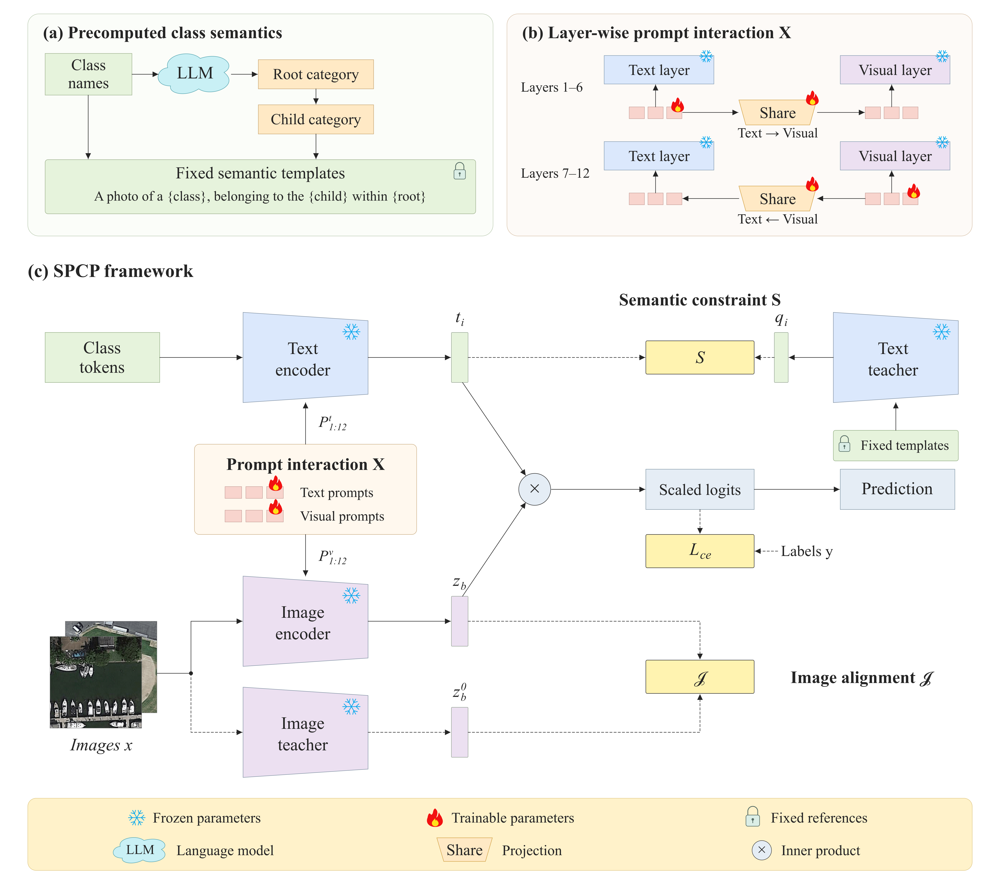

# SPCP: Semantics-Preserving Cross-Modal Prompting

**Generalizable remote sensing scene classification with frozen CLIP.**  
**基于冻结 CLIP 的可泛化遥感场景分类。**

[English](#english) · [中文](#中文) · [Downloads / 下载](docs/DOWNLOADS.md) · [Reproducibility / 复现说明](docs/REPRODUCIBILITY.md) · [Paper figures / 论文图件](docs/figures/README.md)

Implementation accompanying the working manuscript **“Semantics-preserving cross-modal prompting for generalizable remote sensing scene classification.”**  
Authors: **Xingyu Fan, Shengsheng Wang, and Zihao Fu**.



## English

### Method and contents

SPCP jointly trains prompts and two interaction projections while keeping the CLIP encoders and pretrained logit scale frozen:

- **S — Text semantic preservation:** individual frozen class anchors and full coordinate differences on a fixed source-class neighbor graph.
- **I — Image alignment:** prompted and frozen features of the **same augmented image**.
- **X — Cross-modal prompt interaction:** text-to-visual projection in layers 1–6 and visual-to-text projection in layers 7–12, shared within each group.

The full objective is `CE + I + (1−η) A + η E`, with `η=0.50`, `K=3`, and denominator floor `ε=0.20`. We provide base-to-new (**B2N**), cross-dataset (**CD**), and shared-class domain generalization (**DG**) configurations, synthetic CPU tests, fixed templates/splits, and full-method result summaries.

The `spcp` package provides the model, training loop, evaluation, and checkpoint utilities. Configurations and runtime metadata use the method name `SPCP`. See [source identities](docs/source_identity.json) for the release file inventory.

### 1. Download and install

```bash
git clone https://github.com/Cyril-Fan/SPCP.git
cd SPCP
conda create -n spcp python=3.10 -y
conda activate spcp
```

Install a matching PyTorch/torchvision build for your driver. The reference versions are **PyTorch 2.4.1 / torchvision 0.19.1**; historical GPU runs used CUDA 11.8. For that CUDA build:

```bash
python -m pip install torch==2.4.1 torchvision==0.19.1 --index-url https://download.pytorch.org/whl/cu118
python -m pip install -r requirements.txt
python scripts/prepare_protocol_assets.py
python scripts/check_release.py
```

For CPU engineering tests, replace `cu118` with `cpu` in the PyTorch installation command. Formal configs select CUDA with AMP. The metadata preparation command only expands and verifies bundled split files and image-hash ledgers; **it does not download or contain dataset images**. No Dassl installation is required by this implementation.

### 2. Obtain CLIP and datasets

```bash
# Fixed CLIP source + tokenizer; --weights also downloads official ViT-B/16 weights.
python scripts/download_clip.py --weights
python scripts/download_clip.py --weights --check-only
```

The historical experiments use the CLIP implementation distributed with **CoOp**, pinned to commit `ff61507c790454bce7c5052c3ac39e60772f1f89`. The four source-file hashes, BPE hash, and original OpenAI ViT-B/16 checkpoint hash are enforced. Installing an arbitrary latest `clip` package will not satisfy this contract. Downloads are explicit setup steps; training itself never downloads a model.

Download images from the original providers listed in [DOWNLOADS.md](docs/DOWNLOADS.md). B2N/CD use PatternNet, RSICD, NWPU-RESISC45, and MLRSNet. DG uses the **APPLeNet v2 image releases** with the fixed 16 shared classes; substituting the full original datasets changes the protocol.

Copy `image_roots.example.json` to `image_roots.json`, then replace placeholders with your local **absolute paths**. Keep only datasets you have downloaded; a given training command still needs all source/target datasets in its config. The chosen root must resolve IDs such as `oil_well/oilwell107.jpg` (PatternNet) or `baseballfield/baseballfield_225.jpg` (PatternNetv2). Keep the released names and image bytes.

```bash
python scripts/bind_external_assets.py --clip-root external/original_clip --clip-checkpoint external/ViT-B-16.pt --image-roots-json image_roots.json --output external_assets.json
python scripts/bind_external_assets.py --check-binding external_assets.json
```

The binding is local and ignored by Git. It verifies the CLIP assets and path existence; actual training also validates the selected image IDs and DG image bytes against the bundled records. It does not copy data or alter labels.

### 3. Train and evaluate

Run commands from the repository root. Replace the config and output names as needed. Use seeds **1, 2, and 3** for the reported three-seed protocol.

```bash
# Validate metadata without loading a model.
python -m spcp validate-config --config configs/SPCP_b2n_patternnet.yaml --seed 1

# B2N: train on base supports; final evaluation reports Base, New, and HM.
python -m spcp train --config configs/SPCP_b2n_patternnet.yaml --asset-binding external_assets.json --seed 1 --output runs/SPCP_b2n_patternnet_seed1

# CD: PatternNet source -> RSICD / NWPU-RESISC45 / MLRSNet.
python -m spcp train --config configs/SPCP_cd_patternnet.yaml --asset-binding external_assets.json --seed 1 --output runs/SPCP_cd_seed1

# DG: PatternNetv2 source -> the three v2 target domains.
python -m spcp train --config configs/SPCP_dg_patternnetv2.yaml --asset-binding external_assets.json --seed 1 --output runs/SPCP_dg_seed1

# Replay a final checkpoint into a NEW output directory.
python -m spcp evaluate --config configs/SPCP_b2n_patternnet.yaml --asset-binding external_assets.json --seed 1 --checkpoint runs/SPCP_b2n_patternnet_seed1/final.pt --output runs/SPCP_b2n_patternnet_seed1_replay
```

The other B2N configs are `SPCP_b2n_rsicd.yaml`, `SPCP_b2n_resisc45.yaml`, and `SPCP_b2n_mlrsnet.yaml`. Training uses 16 shots, final-epoch checkpoint selection, 50 B2N epochs or 10 CD/DG epochs. Existing output directories are protected. Resume an interrupted completed-epoch checkpoint using the **same config, seed, binding, source tree, and output directory**:

```bash
python -m spcp train --config configs/SPCP_b2n_patternnet.yaml --asset-binding external_assets.json --seed 1 --output runs/SPCP_b2n_patternnet_seed1 --resume runs/SPCP_b2n_patternnet_seed1/last.pt
```

See `python -m spcp train --help` for checkpoint recovery and completed-run verification. A fresh clone is intended for fresh runs; strict identities can reject old checkpoints from a different source tree. Do not remove guards to force a replay.

### 4. Engineering checks

```bash
python scripts/check_release.py
python -m unittest discover -s tests
```

CPU tests use synthetic data and a small fake CLIP to check the full objective, frozen parameters, graph integrity, optimizer/checkpoint recovery, and transfer evaluation. They do not reproduce benchmark accuracies. CI performs these checks without dataset downloads or GPUs.

### Results, checkpoints, and attribution

Existing three-seed summaries: **80.38% B2N macro HM**, **63.07% CD target average**, **84.04% DG target average**. The `results/` directory contains means and seed records; these are saved experiments, not newly executed release tests. B2N HM is computed per dataset and seed before aggregation. Read the reproducibility notes before interpreting comparisons or selecting hyperparameters.

This first release contains source and protocol metadata. **Trained SPCP checkpoints are not distributed in this release**; the commands above produce `final.pt`. The CLIP backbone download is provided separately by the setup script. Dataset images remain with their providers.

SPCP code is released under the [MIT License](LICENSE). We acknowledge [OpenAI CLIP](https://github.com/openai/CLIP), [CoOp](https://github.com/KaiyangZhou/CoOp), and [APPLeNet](https://github.com/mainaksingha01/APPLeNet). See [third-party notices](THIRD_PARTY_NOTICES.md) for upstream licenses and dataset terms.

## 中文

### 方法与代码内容

SPCP 在冻结 CLIP 编码器及其预训练 logit scale 的前提下，联合学习提示参数和两组交互投影，包含三个部分：

- **S：文本语义保持**，结合逐类冻结锚点与固定源类邻居图上的完整坐标差约束。
- **I：图像对齐**，约束同一增强图像的提示分支与冻结分支特征。
- **X：跨模态提示交互**，第 1–6 层文本到视觉、第 7–12 层视觉到文本，各层组共享对应投影。

完整目标为 `CE + I + (1−η) A + η E`，默认 `η=0.50`、`K=3`、分母稳定项 `ε=0.20`。仓库提供完整 SPCP 的 B2N、CD、DG 配置、固定语义模板/划分、既有结果及 CPU 工程测试。

统一使用 `spcp` 包和 `SPCP` 方法名。模型、训练、评估及检查点工具均位于该包，发布文件哈希见 [source_identity.json](docs/source_identity.json)。

### 下载、安装与准备

```bash
git clone https://github.com/Cyril-Fan/SPCP.git
cd SPCP
conda create -n spcp python=3.10 -y
conda activate spcp
python -m pip install torch==2.4.1 torchvision==0.19.1 --index-url https://download.pytorch.org/whl/cu118
python -m pip install -r requirements.txt
python scripts/prepare_protocol_assets.py
python scripts/check_release.py
python scripts/download_clip.py --weights
```

也可从仓库 **Code → Download ZIP** 下载后解压。CUDA 安装命令须与驱动匹配；CPU 工程检查可将 `cu118` 换成 `cpu`。本实现无需安装 Dassl。

`prepare_protocol_assets.py` 只解压并校验随仓库提供的划分和像素哈希记录，不包含、下载或复制数据集图像。CLIP 安装脚本获取固定版本的 **CoOp 随附 CLIP 实现**、BPE 和可选的 OpenAI ViT-B/16 权重，并检查 SHA；训练阶段没有自动下载行为。不要用任意新版 `clip` 包替代。

数据集下载链接与目录示例见 [DOWNLOADS.md](docs/DOWNLOADS.md)。B2N/CD 使用四个原始数据集；DG 使用 APPLeNet 发布的四个 **v2 图像集合**及固定 16 个共有类别。下载后：

1. 复制 `image_roots.example.json` 为 `image_roots.json`，填写已下载数据的绝对路径，并删除尚未下载的条目。
2. 保留发布文件名、目录结构和图像字节；一次运行必须具备其配置涉及的全部源域/目标域数据。
3. 执行以下资产绑定命令。绑定文件含本机路径，已被 Git 忽略。

```bash
python scripts/bind_external_assets.py --clip-root external/original_clip --clip-checkpoint external/ViT-B-16.pt --image-roots-json image_roots.json --output external_assets.json
python scripts/bind_external_assets.py --check-binding external_assets.json
```

### 训练、评估和恢复

在仓库根目录运行。以下示例使用 seed 1；论文的三 seed 汇总需要分别运行 **1、2、3**。

```bash
# 元数据验证，不加载模型
python -m spcp validate-config --config configs/SPCP_b2n_patternnet.yaml --seed 1

# B2N：Base 训练，最终同时输出 Base/New/HM
python -m spcp train --config configs/SPCP_b2n_patternnet.yaml --asset-binding external_assets.json --seed 1 --output runs/SPCP_b2n_patternnet_seed1

# CD：PatternNet -> RSICD、NWPU-RESISC45、MLRSNet
python -m spcp train --config configs/SPCP_cd_patternnet.yaml --asset-binding external_assets.json --seed 1 --output runs/SPCP_cd_seed1

# DG：PatternNetv2 -> 另外三个 v2 域
python -m spcp train --config configs/SPCP_dg_patternnetv2.yaml --asset-binding external_assets.json --seed 1 --output runs/SPCP_dg_seed1

# 将同一运行产生的 final.pt 重新评估到一个新的输出目录
python -m spcp evaluate --config configs/SPCP_b2n_patternnet.yaml --asset-binding external_assets.json --seed 1 --checkpoint runs/SPCP_b2n_patternnet_seed1/final.pt --output runs/SPCP_b2n_patternnet_seed1_replay
```

其他 B2N 配置为 `configs/SPCP_b2n_rsicd.yaml`、`SPCP_b2n_resisc45.yaml` 和 `SPCP_b2n_mlrsnet.yaml`。训练采用 16 shots，B2N 50 epochs，CD/DG 10 epochs，固定使用最终 epoch，不按目标域成绩挑选检查点。

输出目录已有内容时不会直接覆盖。恢复时保持源代码、配置、seed、绑定和输出目录一致，并加上 `--resume 原输出目录/last.pt`；记录过的失败恢复及完成结果复用选项见 `python -m spcp train --help`。旧归档检查点可能因源树身份不同而被拒绝，不应删除校验来强行加载。

### 工程检查、结果与发布范围

```bash
python scripts/check_release.py
python -m unittest discover -s tests
```

CPU 测试使用人工图像和小型 FakeClip，检查完整目标、冻结参数、源图、优化、检查点恢复及迁移评估，不替代真实基准实验。

已有结果为 B2N 宏平均 HM **80.38%**、CD 目标域均值 **63.07%**、DG 目标域均值 **84.04%**。`results/` 仅保留完整方法的逐 seed 与汇总记录；这些是已有实验，不是本次发布重新训练的成绩。HM 按数据集和 seed 计算后再汇总，探索性参数选择的边界见复现说明。

首版发布源码与协议元数据，**暂未发布训练完成的 SPCP 检查点**；按训练命令可生成 `final.pt`。CLIP 权重由安装脚本单独下载，数据集图像从原发布方获取。

SPCP 代码采用 [MIT 许可证](LICENSE)。感谢 OpenAI CLIP、CoOp 和 APPLeNet；第三方来源及许可见 [THIRD_PARTY_NOTICES.md](THIRD_PARTY_NOTICES.md)。论文仍为工作稿。

## Citation / 引用

Cite the software as follows. Publication details will be added when available.

```bibtex
@misc{fan2026spcp,
  title = {SPCP: Semantics-Preserving Cross-Modal Prompting},
  author = {Fan, Xingyu and Wang, Shengsheng and Fu, Zihao},
  year = {2026},
  howpublished = {\url{https://github.com/Cyril-Fan/SPCP}},
  note = {Code accompanying a working manuscript}
}
```

Questions / 联系：please use [GitHub Issues](https://github.com/Cyril-Fan/SPCP/issues).
