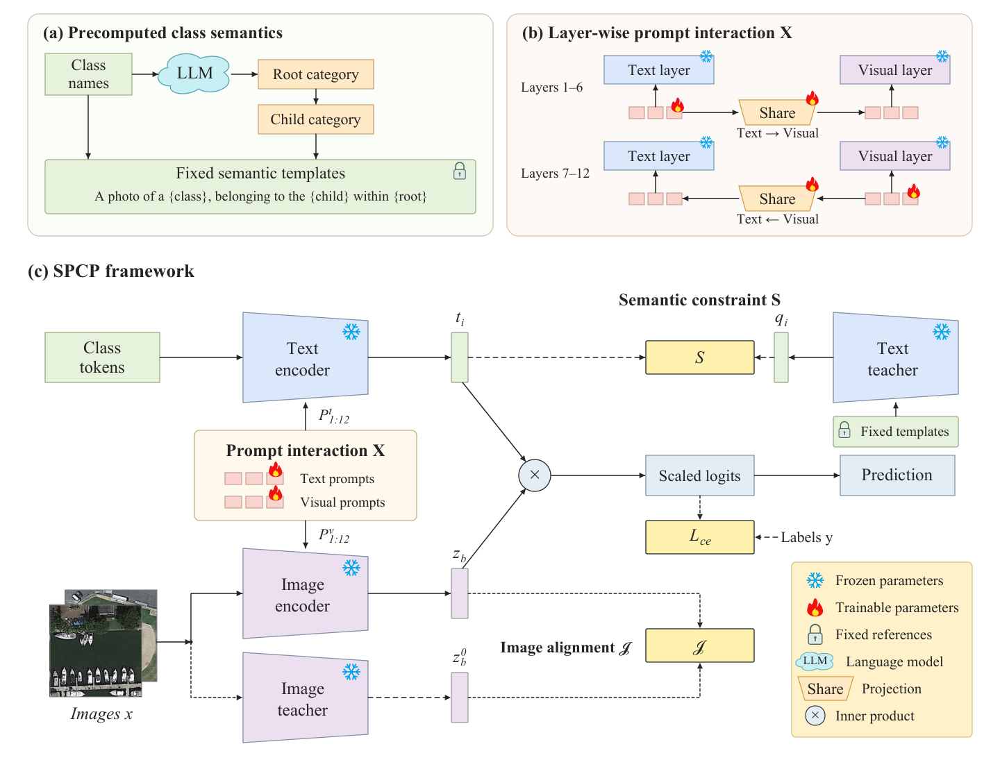

# SPCP: Semantics-Preserving Cross-Modal Prompting

**Remote sensing scene classification with frozen CLIP.**

**基于冻结 CLIP 的遥感场景分类。**

[English](#english) · [中文](#中文) · [Downloads / 下载](docs/DOWNLOADS.md) · [Reproducibility / 复现说明](docs/REPRODUCIBILITY.md) · [Paper figures / 论文图件](docs/figures/README.md)

Implementation of **“Semantics-preserving cross-modal prompting for remote sensing scene classification.”**

Authors: **Xingyu Fan, Fengjie Sun, and Zihao Fu**.



## English

### Method and contents

SPCP jointly trains prompts and two interaction projections while keeping the CLIP encoders and pretrained logit scale frozen:

- **S — Text semantic preservation:** individual frozen class anchors and full class-difference vectors on a fixed source-class neighbor graph.
- **I — Image alignment:** prompted and frozen features of the **same augmented image**.
- **X — Cross-modal prompt interaction:** text-to-visual projection in layers 1–6 and visual-to-text projection in layers 7–12, shared within each group.

The full objective is `CE + I + (1−η) A + η E`, with `η=0.50`, `K=3`, and stabilization parameter `ε=0.20`. We provide base-to-new (**B2N**), cross-dataset (**CD**), and shared-class domain generalization (**DG**) configurations, synthetic CPU tests, fixed templates/splits, and full-method result summaries.

The `spcp/` package contains the model, training, evaluation and checkpoint utilities. The six configurations in `configs/` reproduce the full SPCP method on B2N, CD and DG. See the [reproducibility guide](docs/REPRODUCIBILITY.md) for the fixed settings and configuration checks.

### 1. Download and install

```bash
git clone https://github.com/Cyril-Fan/SPCP.git
cd SPCP
conda create -n spcp python=3.8.20 -y
conda activate spcp
```

The original experiments used **Python 3.8.20, PyTorch 2.4.1, torchvision 0.19.1, CUDA 11.8, NumPy 1.24.4 and Pillow 10.4.0**. `requirements.txt` pins these Python packages; install the matching CUDA build first:

```bash
python -m pip install torch==2.4.1 torchvision==0.19.1 --index-url https://download.pytorch.org/whl/cu118
python -m pip install -r requirements.txt
python scripts/prepare_protocol_assets.py
```

For CPU tests, replace `cu118` with `cpu` in the PyTorch installation command. The training configs use CUDA with AMP. The metadata preparation command extracts bundled splits and image-hash ledgers; obtain dataset images separately in the next step. Dassl is not required.

### 2. Obtain CLIP and datasets

```bash
# Fixed CLIP source + tokenizer; --weights also downloads official ViT-B/16 weights.
python scripts/download_clip.py --weights
python scripts/download_clip.py --weights --check-only
```

SPCP uses the CLIP implementation distributed with **CoOp** at commit `ff61507c790454bce7c5052c3ac39e60772f1f89`. The setup script downloads and verifies these source files, the tokenizer and OpenAI ViT-B/16 weights. Training loads them locally; it does not download assets.

Download images from the original providers listed in [DOWNLOADS.md](docs/DOWNLOADS.md). B2N/CD use PatternNet, RSICD, NWPU-RESISC45, and MLRSNet. DG uses the **APPLeNet v2 image releases** with the fixed 16 shared classes; substituting the full original datasets changes the protocol.

Copy `image_roots.example.json` to `image_roots.json`, then replace placeholders with your local **absolute paths**. Keep only datasets you have downloaded; a given training command still needs all source/target datasets in its config. The chosen root must resolve IDs such as `oil_well/oilwell107.jpg` (PatternNet) or `baseballfield/baseballfield_225.jpg` (PatternNetv2). Keep the released names and image bytes.

```bash
python scripts/bind_external_assets.py --clip-root external/original_clip --clip-checkpoint external/ViT-B-16.pt --image-roots-json image_roots.json --output external_assets.json
python scripts/bind_external_assets.py --check-binding external_assets.json
```

The binding stores local asset paths and is ignored by Git. Training checks image IDs and, for DG, image hashes against the bundled records.

### 3. Train and evaluate

Run commands from the repository root. Replace the config and output names as needed. Use seeds **1, 2, and 3** for the reported three-seed protocol.

```bash
# Validate metadata without loading a model.
python -m spcp validate-config --config configs/SPCP_b2n_patternnet.yaml --seed 1

# B2N: train on base supports; final evaluation reports Base, New, and HM.
python -m spcp train --config configs/SPCP_b2n_patternnet.yaml --asset-binding external_assets.json --seed 1 --output runs/SPCP_b2n_patternnet_seed1

# CD: PatternNet source -> RSICD / NWPU-RESISC45 / MLRSNet.
python -m spcp train --config configs/SPCP_cd_patternnet.yaml --asset-binding external_assets.json --seed 1 --output runs/SPCP_cd_seed1

# DG: PatternNetv2 source -> the three v2 target domains.
python -m spcp train --config configs/SPCP_dg_patternnetv2.yaml --asset-binding external_assets.json --seed 1 --output runs/SPCP_dg_seed1

# Evaluate a final checkpoint in a new output directory.
python -m spcp evaluate --config configs/SPCP_b2n_patternnet.yaml --asset-binding external_assets.json --seed 1 --checkpoint runs/SPCP_b2n_patternnet_seed1/final.pt --output runs/SPCP_b2n_patternnet_seed1_replay
```

The other B2N configs are `SPCP_b2n_rsicd.yaml`, `SPCP_b2n_resisc45.yaml`, and `SPCP_b2n_mlrsnet.yaml`. Training uses 16 shots, final-epoch checkpoint selection, 50 B2N epochs or 10 CD/DG epochs. To continue after an interruption, use the same training settings, seed, assets and output directory. Resume starts at the last completed epoch:

```bash
python -m spcp train --config configs/SPCP_b2n_patternnet.yaml --asset-binding external_assets.json --seed 1 --output runs/SPCP_b2n_patternnet_seed1 --resume runs/SPCP_b2n_patternnet_seed1/last.pt
```

See `python -m spcp train --help` for recovery options and the [checkpoint guide](docs/REPRODUCIBILITY.md#checkpoints) for compatibility requirements.

### 4. Check the installation

```bash
python scripts/check_release.py
python -m unittest discover -s tests
```

CPU tests use synthetic data and a small fake CLIP to check the full objective, frozen parameters, graph integrity, optimizer/checkpoint recovery, and transfer evaluation. They do not reproduce benchmark accuracies. CI performs these checks without dataset downloads or GPUs.

### Results and checkpoints

Three-seed results: **80.38% B2N macro HM**, **63.07% CD target average**, **84.04% DG target average**. The `results/` directory provides per-seed scores and their summaries. B2N HM is computed per dataset and seed before aggregation.

**Trained SPCP checkpoints are not currently distributed**; the training commands produce `final.pt`. Download the CLIP backbone with the setup script and dataset images from their providers.

SPCP code is released under the [MIT License](LICENSE). We acknowledge [OpenAI CLIP](https://github.com/openai/CLIP), [CoOp](https://github.com/KaiyangZhou/CoOp), and [APPLeNet](https://github.com/mainaksingha01/APPLeNet). See [third-party notices](THIRD_PARTY_NOTICES.md) for upstream licenses and dataset terms.

## 中文

### 方法与代码内容

SPCP 在冻结 CLIP 编码器及其预训练 logit scale 的前提下，联合学习提示参数和两组交互投影，包含三个部分：

- **S：文本语义保持**，结合逐类冻结锚点与固定源类邻居图上的完整类间差向量约束。
- **I：图像对齐**，约束同一增强图像的提示分支与冻结分支特征。
- **X：跨模态提示交互**，第 1–6 层文本到视觉、第 7–12 层视觉到文本，各层组共享对应投影。

完整目标为 `CE + I + (1−η) A + η E`，默认 `η=0.50`、`K=3`、分母稳定项 `ε=0.20`。仓库提供完整 SPCP 的 B2N、CD、DG 配置、固定语义模板/划分、既有结果及 CPU 工程测试。

`spcp/` 包包含模型、训练、评估和检查点工具。`configs/` 中的六份配置用于复现完整 SPCP 的 B2N、CD 和 DG 实验；固定设置及配置检查见[复现说明](docs/REPRODUCIBILITY.md)。

### 下载、安装与准备

原始实验环境为 **Python 3.8.20、PyTorch 2.4.1、torchvision 0.19.1、CUDA 11.8、NumPy 1.24.4、Pillow 10.4.0**。依赖文件固定上述 Python 包版本，先安装对应 CUDA 构建。CI 使用相同 Python 和核心包版本的 CPU 构建进行工程检查，不替代 GPU 实验。

```bash
git clone https://github.com/Cyril-Fan/SPCP.git
cd SPCP
conda create -n spcp python=3.8.20 -y
conda activate spcp
python -m pip install torch==2.4.1 torchvision==0.19.1 --index-url https://download.pytorch.org/whl/cu118
python -m pip install -r requirements.txt
python scripts/prepare_protocol_assets.py
python scripts/download_clip.py --weights
```

也可从仓库 **Code → Download ZIP** 下载后解压。CUDA 安装命令须与驱动匹配；CPU 工程检查可将 `cu118` 换成 `cpu`。本实现无需安装 Dassl。

`prepare_protocol_assets.py` 解压并校验随仓库提供的划分和像素哈希记录，数据集图像需单独获取。CLIP 安装脚本下载并校验固定版本的 **CoOp 随附 CLIP 实现**、BPE 和可选的 OpenAI ViT-B/16 权重；训练命令加载这些本地文件。

数据集下载链接与目录示例见 [DOWNLOADS.md](docs/DOWNLOADS.md)。B2N/CD 使用四个原始数据集；DG 使用 APPLeNet 发布的四个 **v2 图像集合**及固定 16 个共有类别。下载后：

1. 复制 `image_roots.example.json` 为 `image_roots.json`，填写已下载数据的绝对路径，并删除尚未下载的条目。
2. 保留发布文件名、目录结构和图像字节；一次运行必须具备其配置涉及的全部源域/目标域数据。
3. 执行以下资产绑定命令。绑定文件含本机路径，已被 Git 忽略。

```bash
python scripts/bind_external_assets.py --clip-root external/original_clip --clip-checkpoint external/ViT-B-16.pt --image-roots-json image_roots.json --output external_assets.json
python scripts/bind_external_assets.py --check-binding external_assets.json
```

### 训练、评估和恢复

在仓库根目录运行。以下示例使用 seed 1；论文的三 seed 汇总需要分别运行 **1、2、3**。

```bash
# 元数据验证，不加载模型
python -m spcp validate-config --config configs/SPCP_b2n_patternnet.yaml --seed 1

# B2N：Base 训练，最终同时输出 Base/New/HM
python -m spcp train --config configs/SPCP_b2n_patternnet.yaml --asset-binding external_assets.json --seed 1 --output runs/SPCP_b2n_patternnet_seed1

# CD：PatternNet -> RSICD、NWPU-RESISC45、MLRSNet
python -m spcp train --config configs/SPCP_cd_patternnet.yaml --asset-binding external_assets.json --seed 1 --output runs/SPCP_cd_seed1

# DG：PatternNetv2 -> 另外三个 v2 域
python -m spcp train --config configs/SPCP_dg_patternnetv2.yaml --asset-binding external_assets.json --seed 1 --output runs/SPCP_dg_seed1

# 将同一运行产生的 final.pt 重新评估到一个新的输出目录
python -m spcp evaluate --config configs/SPCP_b2n_patternnet.yaml --asset-binding external_assets.json --seed 1 --checkpoint runs/SPCP_b2n_patternnet_seed1/final.pt --output runs/SPCP_b2n_patternnet_seed1_replay
```

其他 B2N 配置为 `configs/SPCP_b2n_rsicd.yaml`、`SPCP_b2n_resisc45.yaml` 和 `SPCP_b2n_mlrsnet.yaml`。训练采用 16 shots，B2N 50 epochs，CD/DG 10 epochs，固定使用最终 epoch，不按目标域成绩挑选检查点。

恢复训练时使用相同的训练设置、seed、资产及输出目录，并指定 `--resume 原输出目录/last.pt`，从最后完成的 epoch 继续。其他恢复选项见 `python -m spcp train --help`，兼容条件见[检查点说明](docs/REPRODUCIBILITY.md#checkpoints)。

### 安装检查与结果

```bash
python scripts/check_release.py
python -m unittest discover -s tests
```

CPU 测试使用人工图像和小型 FakeClip，检查完整目标、冻结参数、源图、优化、检查点恢复及迁移评估，不替代真实基准实验。

已有结果为 B2N 宏平均 HM **80.38%**、CD 目标域均值 **63.07%**、DG 目标域均值 **84.04%**。`results/` 提供完整方法的逐 seed 结果及汇总。HM 按数据集和 seed 计算后再汇总。

**暂未发布训练完成的 SPCP 检查点**；训练命令生成 `final.pt`。CLIP 权重由安装脚本下载，数据集图像从原发布方获取。

SPCP 代码采用 [MIT 许可证](LICENSE)。感谢 OpenAI CLIP、CoOp 和 APPLeNet；第三方来源及许可见 [THIRD_PARTY_NOTICES.md](THIRD_PARTY_NOTICES.md)。

## Citation / 引用

To cite this implementation:

```bibtex
@misc{fan2026spcp,
  title = {SPCP: Semantics-Preserving Cross-Modal Prompting},
  author = {Fan, Xingyu and Sun, Fengjie and Fu, Zihao},
  year = {2026},
  howpublished = {\url{https://github.com/Cyril-Fan/SPCP}}
}
```

Questions / 联系：please use [GitHub Issues](https://github.com/Cyril-Fan/SPCP/issues).
