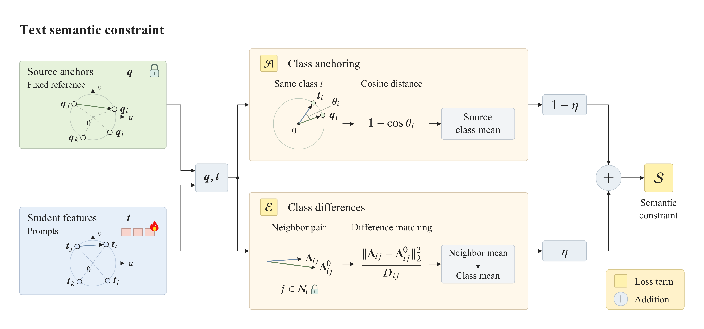

# Paper figures / 论文图件

PNG files provide previews, SVG files retain editable sources, and PDFs provide
publication exports. Both architecture schematics retain vector geometry and
embedded fonts in their PDFs; PNGs are screen previews. Filenames identify the figure assets.

| Content | Files |
|---|---|
| Motivation / 语义保持动机 | [PNG](SPCP_introduction_motivation.png) · [SVG](SPCP_introduction_motivation.svg) · [PDF](SPCP_introduction_motivation.pdf) |
| SPCP framework / 总体框架 | [PNG](SPCP_overall.png) · [SVG](SPCP_overall.svg) · [PDF](SPCP_overall.pdf) |
| Text semantic constraint / 文本语义约束 | [PNG](SPCP_core.png) · [SVG](SPCP_core.svg) · [PDF](SPCP_core.pdf) |
| Directional distortion / 方向畸变 | [PNG](Fig3_direction_distortion.png) · [SVG](Fig3_direction_distortion.svg) · [PDF](Fig3_direction_distortion.pdf) |
| Length distortion / 长度畸变 | [PNG](Fig4_length_distortion.png) · [SVG](Fig4_length_distortion.svg) · [PDF](Fig4_length_distortion.pdf) |
| Class-wise recognition changes / 类别识别变化 | [PNG](Fig5_classwise_errors.png) · [SVG](Fig5_classwise_errors.svg) · [PDF](Fig5_classwise_errors.pdf) |

## Structure diagrams

Both diagrams are 160 mm wide. The PDFs preserve vector geometry and embedded
fonts; PNGs are previews. The semantic diagram compares prompted and reference
differences for the same class pair on fixed source-class neighborhoods.
Mathematical labels use NewTX calligraphic losses and bold-italic vectors.
Layer indices are superscripts and modality indices are subscripts. The full-layer
prompt labels include both native and projected prompts.

At the native 160 mm width, strokes in the text-semantic diagram are at least
0.302 pt. Its loss backgrounds are centered squares, with math positions stored
in the editable manifest.

See [the export instructions](source/README.md) for the self-contained
figure-building code and its separate optional authoring dependencies.

## Motivation

Frozen CLIP encodes fixed LLM-assisted descriptions into class references.
Open circles show these references; filled circles show prompted text features.
The panels illustrate semantic drift and the SPCP preservation objective using
conceptual coordinates, not measured embeddings. The supplied figure is 160 × 64 mm.
Its ordinary text has embedded fonts in the PDF; mathematical symbols are outlines.

## Analysis figures

In the class-wise figure, thin cell and marker outlines are 0.32 pt;
the left-side class indices use neutral gray #666666 (5.74:1 against white).
Other plotted colors, positions and values are unchanged.

Full and w/o S differ jointly in the absolute
and interclass text losses. New-class graphs are used solely for analysis, not training.
Closer reference geometry does not imply uniform recognition gains: Full increases
NWPU-RESISC45 new-class accuracy by 5.30 percentage points and decreases PatternNet
new-class accuracy by 3.67 points relative to w/o S.

本目录按图件内容组织。动机图是概念示意，不是实验嵌入结果；
Full 与 w/o S 同时涉及两项文本损失，
不能把 HM 差异直接归因于某一种畸变的变化。
