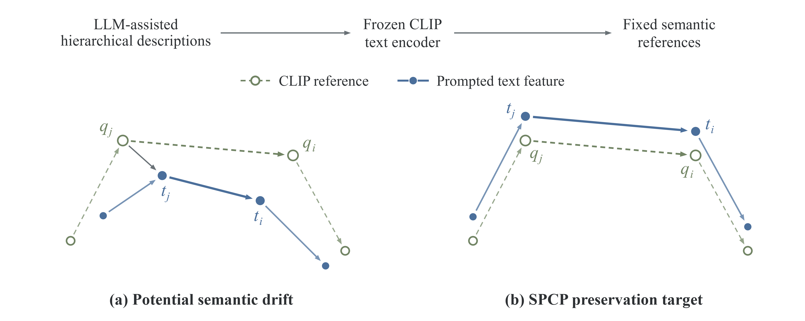
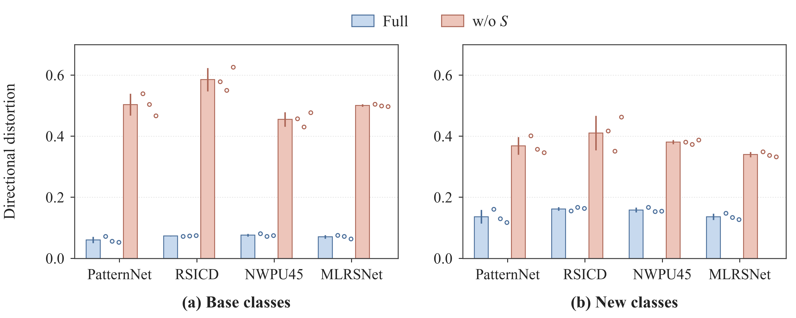
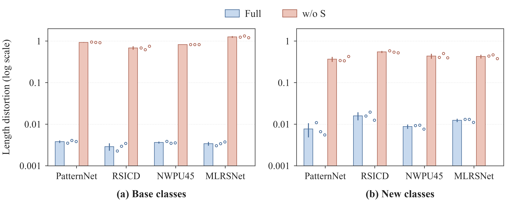
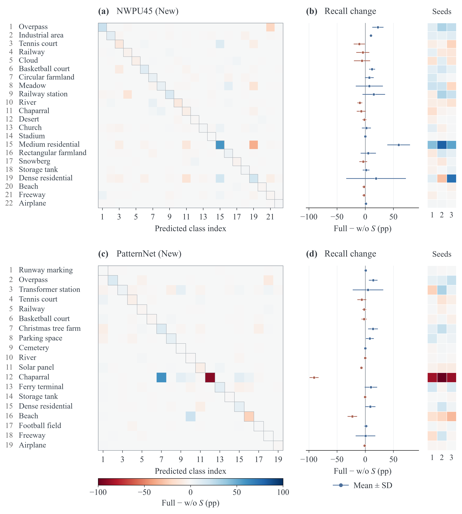

# Paper figures / 论文图件

PNG files provide previews, SVG files retain editable sources, and PDFs provide
publication exports. The core-constraint PDF contains a high-resolution raster;
the other PDFs retain vector content. Filenames are stable asset identifiers,
not manuscript version identifiers or a promise of current figure numbering.

| Content | Files |
|---|---|
| Motivation / 语义保持动机 | [PNG](SPCP_introduction_motivation.png) · [SVG](SPCP_introduction_motivation.svg) · [PDF](SPCP_introduction_motivation.pdf) |
| SPCP framework / 总体框架 | [PNG](SPCP_overall.png) · [SVG](SPCP_overall.svg) · [PDF](SPCP_overall.pdf) |
| Text semantic constraint / 文本语义约束 | [PNG](SPCP_core.png) · [SVG](SPCP_core.svg) · [PDF](SPCP_core.pdf) |
| Directional distortion / 方向畸变 | [PNG](Fig3_direction_distortion.png) · [SVG](Fig3_direction_distortion.svg) · [PDF](Fig3_direction_distortion.pdf) |
| Length distortion / 长度畸变 | [PNG](Fig4_length_distortion.png) · [SVG](Fig4_length_distortion.svg) · [PDF](Fig4_length_distortion.pdf) |
| Class-wise recognition changes / 类别识别变化 | [PNG](Fig5_classwise_errors.png) · [SVG](Fig5_classwise_errors.svg) · [PDF](Fig5_classwise_errors.pdf) |

## Motivation

Frozen CLIP encodes fixed LLM-assisted descriptions into class references.
Open circles show these references; filled circles show prompted text features.
The panels illustrate semantic drift and the SPCP preservation objective using
conceptual coordinates, not measured embeddings. The supplied figure is 160 × 64 mm.
Its ordinary text has embedded fonts in the PDF; mathematical symbols are outlines.

Optional regeneration uses `motivation_source/draw_motivation.py` and the dependencies
in `motivation_source/requirements.txt`, in a separate plotting environment with
Times New Roman installed. It writes `SPCP_introduction_motivation.*` in this directory
and a `qa/` directory. It does not train a model or read experimental measurements.

## Analysis figures

The [analysis data and plotting tools](../../analysis/README.md) reproduce these plots
from seed-level and class-level records. Full and w/o S differ jointly in the absolute
and interclass text losses. New-class graphs are used solely for analysis, not training.
Closer reference geometry does not imply uniform recognition gains: Full increases
NWPU-RESISC45 new-class accuracy by 5.30 percentage points and decreases PatternNet
new-class accuracy by 3.67 points relative to w/o S.

本目录按图件内容组织，不绑定稿件版本。动机图是概念示意，不是实验嵌入结果；
分析数据和绘图工具见上述链接。Full 与 w/o S 同时涉及两项文本损失，
不能把 HM 差异直接归因于某一种畸变的变化。
